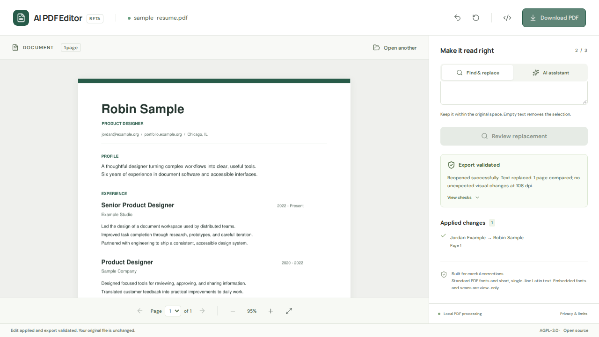

# AI PDF Editor

Careful corrections to existing PDF text, with an explicit review step and checks on the **actual exported PDF**. Manual editing stays on your device and works without an AI provider.

**Status: COMPLETE for the documented MVP scope.** [Open the live editor](https://ai-pdf-editor.pages.dev). Production manual editing/export and real Turnstile → Groq proposal → review → apply → download have passed, including independent PDF.js verification. See [production evidence](docs/PRODUCTION-VERIFICATION.md) and [current CI/deployment runs](https://github.com/academ1cian/ai-pdf-editor/actions).



## What works

- PDF upload/drop, multi-page navigation, zoom, fit-to-width, selectable text lines and exact find.
- Explicit occurrence selection when text appears multiple times.
- Review source/replacement, page/position, font/size, measured fit and rejection reasons.
- Actual source-text removal through applied redaction, followed by real page-content insertion. No rectangle covering old text and no annotation-only mock edits.
- Export validation: reopen, page count, exact changed-region text, neighboring glyph positions, hyperlinks and all-page pixel comparison.
- Immutable original, validated snapshots, undo, reset, change history and genuinely modified downloads.
- Optional AI proposals through a protected Groq Worker; real production integration verified. Manual editing works independently of AI availability.

## Honest support boundaries

This release edits short **single-line printable Latin ASCII text in standard Helvetica, Times and Courier PDF fonts**. Replacement width must fit the original span. It preserves original size, baseline and color; it does not shrink text, substitute fonts or reflow paragraphs.

Embedded/subset/custom fonts (including Cyrillic), scans, forms/signatures, encrypted/restricted/repaired PDFs, tagged semantic trees, rotation/skew, clipping, outlined/transparent text and difficult overlaps are rejected or view-only. Upload limits: 15 MB, 80 pages, bounded page dimensions and text counts. History: 20 edits or 80 MB. Engine work runs in a Web Worker with a 45-second timeout.

Validation at 108 dpi is evidence, not a guarantee of every printer, viewer or PDF feature. This editor is **not a certified document sanitization product**: content could also exist in metadata, attachments or other locations.

## Measured editing gate

**31 distinct synthetic PDFs investigated: 23 PASS, 8 EXPECTED UNSUPPORTED, 0 FAIL.** Fixtures cover English, Cyrillic, standard/embedded/subset fonts, font styles/sizes, longer/shorter strings, duplicates, multiple pages, resumes, invoices, tables, vectors, nearby text, colors, hyperlinks and difficult cases. They contain no real private information.

Every successful proof-of-concept export reopened with independent PDF.js extraction. Every affected and unaffected page was raster-compared at 108 dpi; zero unexpected pixels outside the original target span plus a two-pixel antialias margin. The original input remained unchanged. See [engine decision](docs/ADR-001-pdf-engine.md), [test matrix](docs/TEST-MATRIX.md) and [machine-readable evidence](tests/evidence/results.json).

GitHub-hosted verification passed **34 unit/integration/safety tests** and **12 end-to-end tests across Chromium, Firefox and WebKit**, plus typecheck, lint, production build and Worker dry-run. The actual public deployment passed **4 Chromium production smoke cases**. A separate hosted PDF.js check independently verified the real AI-downloaded export: replacement searchable, original target absent, same page count and all other extracted text preserved.

## Architecture

```mermaid
flowchart LR
    PDF[Local PDF] --> W[Browser Web Worker]
    W --> M[Structured document model]
    M --> R[Explicit target and proposal review]
    R --> E[MuPDF redaction + page text insertion]
    E --> V[Reopen + structural + pixel validation]
    V --> D[Validated PDF download]
    M -.consented current-page text.-> API[Cloudflare Pages API binding]
    API --> P[Worker: request + Turnstile checks]
    P --> B[SQLite Durable Object budget]
    B --> G[Groq strict structured proposal]
    G --> R
```



The reusable engine (`src/engine`) is independent of React. It separates extraction/modeling, targeting/geometry, mutation, validation, worker transport and history. MuPDF was selected after measuring real removal and insertion; PDF.js independently verifies exports. pdf-lib generates fixtures. AI never edits PDF bytes or declares an edit successful.

## AI and privacy

Groq `openai/gpt-oss-20b` supports strict JSON-schema outputs as verified on 2026-10-14. The selected ID is configurable from a documented allowlist. Zod validates both incoming context and proposed edits; the proxy resolves references against actual supplied blocks and the client re-resolves targets before deterministic layout checks.

Only consented current-page extracted text (up to 12,000 characters), block references and the instruction go to Groq. PDFs are never uploaded/stored. No content logging or analytics. Turnstile verification requires the actual hostname/action; origin, payload, output and token limits fail closed. An atomic SQLite Durable Object reserves a global 40 requests / 50,000 conservative tokens per UTC day and limits each client to 2/minute and 6/day. Failed requests are not refunded. Hashes are day-scoped and salted; raw IPs are not stored in budget counters.

## Development and remote verification

On a development machine or GitHub Codespace with Node 24 and pnpm 11.25.0:

```sh
pnpm install --frozen-lockfile
pnpm fixtures
pnpm dev
pnpm typecheck
pnpm lint
pnpm test
pnpm poc
pnpm build
pnpm exec playwright install chromium firefox webkit
pnpm test:e2e
```

**No local tool installation is needed for the owner.** GitHub-hosted Ubuntu runners execute CI and browser compatibility tests. The repository deployment workflow builds separately from secret provisioning; Groq credentials never enter Vite's environment or frontend artifacts.

## Deploy with repository secrets

Use [GitHub repository secrets](https://github.com/academ1cian/ai-pdf-editor/settings/secrets/actions), entered directly in the browser:

| Secret | Purpose |
|---|---|
| `GROQ_API_KEY` | Groq Free provider key; only the secret-provisioning step receives it |
| `CLOUDFLARE_API_TOKEN` | Scoped Pages/Worker deployment and read-only plan verification |
| `CLOUDFLARE_ACCOUNT_ID` | Chosen Cloudflare account |
| `TURNSTILE_SECRET` | Server verification secret for the real widget |

Public repository variables: `TURNSTILE_SITE_KEY`, `CF_FREE_PLAN_CONFIRMED=true` after verifying both providers are Free, and `DEPLOY_ENABLED=true` when ready. Deployed Pages project: `ai-pdf-editor`; verified production hostname: [`ai-pdf-editor.pages.dev`](https://ai-pdf-editor.pages.dev). Authenticated project creation checks the returned hostname and stops on a collision.

Read [deployment instructions and minimum authorization](docs/DEPLOYMENT.md). Deployment sends secret values directly over TLS to Cloudflare's Worker Secret API; no secret-valued shell arguments, temporary files, uploaded artifacts or log output. It checks the account's subscriptions read-only and refuses paid/unrecognized account plans. No billing/subscription writes are implemented. Forked PRs cannot deploy. Production smoke testing runs in a separate job without deployment/provider credentials.

## License and reuse

Combined application: **AGPL-3.0-only**, with [full license](LICENSE) and [dependency inventory](docs/DEPENDENCY-LICENSES.md). MuPDF is AGPL-3.0-or-later, not MIT. Proprietary reuse of this combined engine requires replacing MuPDF or obtaining appropriate commercial licensing from Artifex. Preserve upstream notices and provide corresponding source when distributing or hosting modified versions. Self-hosted UI fonts use SIL OFL-1.1.

## Next improvements

1. Extend font reuse only after embedded glyph mapping and embedding-right checks pass new fixtures.
2. Add independent render comparisons at multiple scales and larger legitimate redistributable corpora.
3. Add deeper PDF feature validation and broader document support without weakening rejection rules.

Execution state and outstanding work: [progress log](docs/PROGRESS.md).
